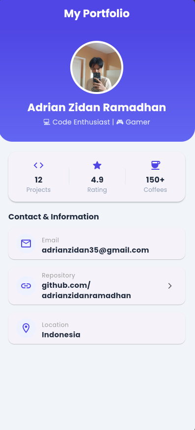

# Mini Portfolio App

Aplikasi Flutter satu halaman (single page) yang menampilkan profil developer. Dibangun sesuai spesifikasi tugas pemrograman mobile: menggunakan kombinasi widget dasar, layout, Container, Card/ListTile, ThemeData global, serta font custom.

## Checklist Kebutuhan Tugas

- [x] **Single Page Application** — seluruh konten di satu halaman `ProfilePage`.
- [x] **Widget Dasar** (minimal 3):
  - `Text` — nama, role, label info kontak.
  - `Image` — foto profil (menggunakan `CircleAvatar` + placeholder).
  - `Icon` — ikon statistik, kontak, dan aksi.
- [x] **Widget Layout** (minimal 2):
  - `Row` — baris statistik (Projects / Rating / Coffees).
  - `Column` — struktur vertikal utama (header, card, list informasi).
- [x] **Container** — styling header gradasi, dekorasi avatar, dan pemisah.
- [x] **Card & ListTile** — menampilkan data kontak (Email, Repository, Location).
- [x] **ThemeData** — tema global (`primaryColor`, `colorScheme`, `textTheme`).
- [x] **Font Custom** — font **Poppins** dari `assets/fonts/` (`CustomFont`).
- [x] **Semua kode di `lib/main.dart`** — sesuai ketentuan satu file.

## Screenshots

> **Cara menambahkan screenshot:**
> 1. Jalankan aplikasi di emulator atau device.
> 2. Simpan tangkapan layar ke folder `assets/screenshots/`.
> 3. Ganti nama file di bawah sesuai nama file screenshot-mu.



## Struktur Project

```
├── assets/
│   ├── fonts/
│   │   ├── Poppins-Regular.ttf
│   │   └── Poppins-Bold.ttf
│   ├── images/
│   │   └── profile.png
│   └── screenshots/        ← letakkan screenshot hasil aplikasi di sini
│       ├── screenshot1.png
│       ├── screenshot2.png
│       └── screenshot3.png
├── lib/
│   └── main.dart
└── pubspec.yaml
```

## Cara Menjalankan

1. Pastikan Flutter SDK sudah terinstall.
2. Jalankan `flutter pub get` untuk menginstall dependency.
3. Ganti foto profil di `main.dart` dengan `AssetImage('assets/images/profile.png')` jika ingin pakai gambar lokal.
4. Jalankan aplikasi:
   ```bash
   flutter run
   ```

## Catatan

- Foto profil saat ini menggunakan placeholder dari Unsplash agar langsung tampil saat testing. Kamu bisa menggantinya dengan aset lokal.
- Semua kode berada di satu file `lib/main.dart` sesuai ketentuan tugas.
- Tema global (`ThemeData`) sudah diterapkan di `MaterialApp` untuk konsistensi warna dan font.
